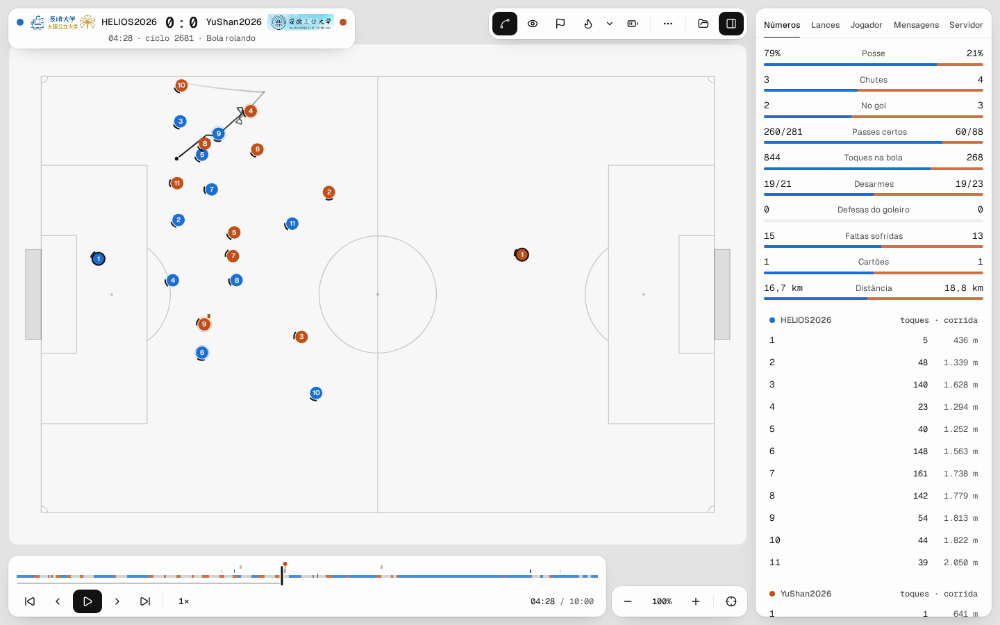
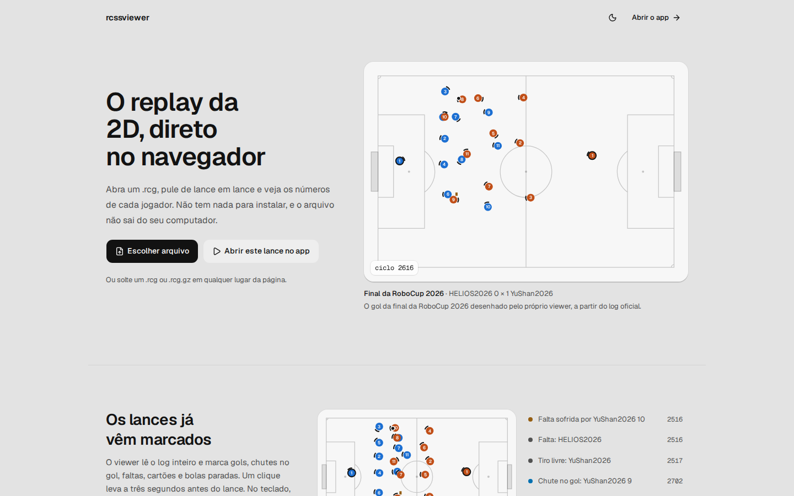
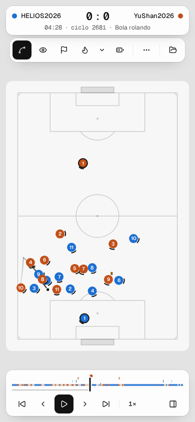

# rcss2d-viewer

Todo jogo de RoboCup Soccer Simulation 2D deixa um log `.rcg`, mas ninguém quer ler um arquivo de 10 MB de texto. O viewer abre esse log no navegador e mostra a partida: dá para pular direto para um gol, ver quem correu mais, onde a bola passou mais tempo, quem estava em impedimento.

O arquivo é lido no seu computador. Nada é enviado para servidor nenhum.



## Como acessar

Entre em https://rcssviewer.tapout.gg. Não tem nada para instalar.

Arraste um `.rcg` ou `.rcg.gz` para a página, ou clique em "Escolher arquivo". Sem log à mão, a página inicial tem um lance da final da RoboCup 2026 para você testar.

Algumas coisas que ajudam:

- `?` abre a lista de atalhos. Espaço toca e pausa, `G` vai para o próximo gol.
- `/app?url=https://…/partida.rcg.gz` abre um log pelo endereço, se o servidor dele liberar CORS.
- `#t=1234` no final do endereço pula para o ciclo 1234. Dá para mandar o link de um lance para alguém.
- Abre `.rcg` de texto nas versões 4 a 6, com ou sem gzip. O rcssserver 19 grava a v6. O formato binário antigo (v1 a v3) não abre.

 

## Como rodar na sua máquina

Você precisa do [Bun](https://bun.sh) (1.3.6 ou mais novo) e do [just](https://github.com/casey/just).

```bash
just install   # baixa as dependências
just dev       # sobe em https://rcss2d-viewer.localhost
```

Na primeira vez o `just dev` pede `sudo`, porque o portless cria um certificado local. Se preferir evitar isso, `bun run dev:host` sobe o Vite em `http://localhost:5173`. Rode só `just` para ver as outras receitas.

Quer ver uma partida enquanto ela acontece? Dá, com uma ponte local entre o rcssserver e a página (`just relay`). O passo a passo está em [docs/ao-vivo.md](docs/ao-vivo.md).

## Como contribuir

Issue e PR são bem-vindos, em português ou em inglês.

A ajuda mais útil é um log que não abre. Abra uma issue com o arquivo (ou um pedaço dele, com o cabeçalho) e diga qual versão do rcssserver gravou.

Se quiser mexer no código, rode `just install` e `just browsers`, crie uma branch e confira que o `just ci` passa antes de abrir o PR. O [CONTRIBUTING.md](CONTRIBUTING.md) tem o resto. Para entender o código, comece por [docs/arquitetura.md](docs/arquitetura.md), e as regras de estilo estão no [AGENTS.md](AGENTS.md).

## Licença

[GPL-3.0 ou posterior](LICENSE). Pode usar, estudar e mudar, e quem repassar o programa entrega o código junto. O trecho da final da RoboCup 2026 e as fontes Geist têm licenças próprias, descritas no [NOTICE](NOTICE).
